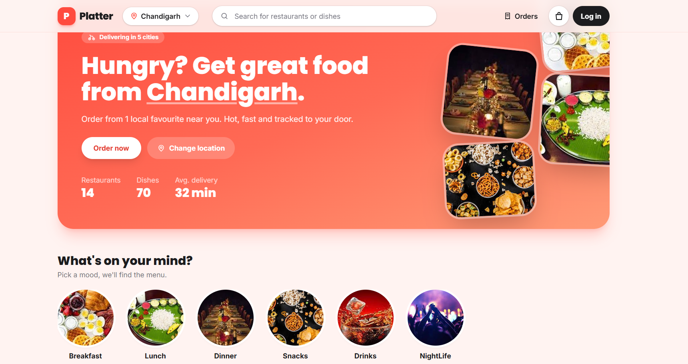
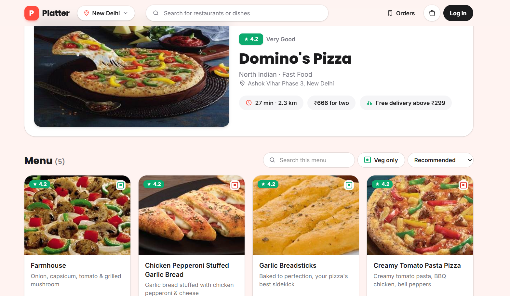
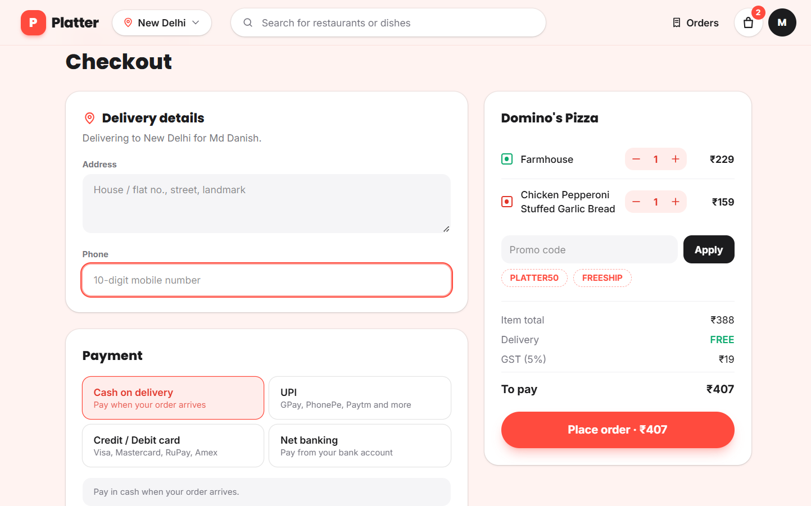
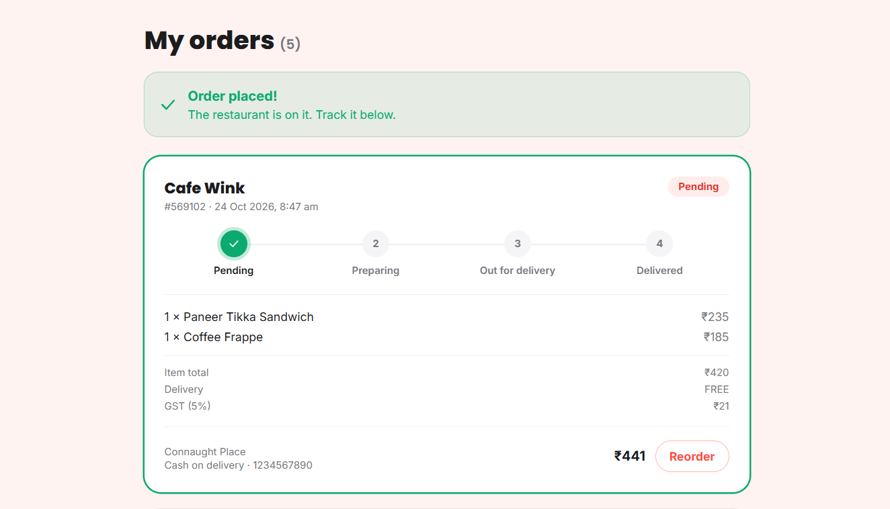

# Platter

A full-stack food delivery app. Browse restaurants by city, search for dishes, build a cart, place an order, and track it, all backed by a real REST API and MongoDB database.

> Built as a portfolio project to practise the full path from UI to database: React frontend, Express API, MongoDB, and authentication.

**Live demo:** coming soon

## Screenshots

| Home | Restaurant menu |
|---|---|
|  |  |

| Checkout | Order tracking |
|---|---|
|  |  |

## Features

- **Browse by city:** pick a city and see its restaurants, with filters for cuisine, rating, pure veg, and sorting
- **Restaurant pages:** full menu, veg-only filter, menu search, and price sorting
- **Search:** restaurants and dishes searched in the database, with a short delay while typing
- **Cart:** one restaurant at a time, with a prompt before switching, saved in the browser
- **Checkout:** delivery details, promo codes (`PLATTER50`, `FREESHIP`), and payment options (cash, UPI, card, net banking as a demo form)
- **Orders:** every order saved in the database, with a live status tracker (Pending, Preparing, Out for delivery, Delivered) and one-click reorder
- **Accounts:** signup, login, logout, show/hide password, and a session that survives page refreshes
- **Loading and error states** on every page that fetches data, with retry buttons
- **Responsive and accessible:** works on phones, keyboard-friendly, labelled controls

## Tech stack

| Layer | Technology |
|---|---|
| Frontend | React 19, Vite, React Router 7, Tailwind CSS 4, Context API |
| Backend | Node.js, Express, Mongoose |
| Database | MongoDB (Atlas) |
| Auth and security | JWT in an httpOnly cookie, bcrypt, Zod validation, Helmet, CORS, rate limiting |

## Security highlights

- Passwords hashed with **bcrypt** (cost 12), never stored or returned in plain text
- Login token kept in an **httpOnly cookie**, so JavaScript in the page can't read it
- **Account lockout** after 5 wrong passwords (15 minutes), plus **IP rate limiting** on auth routes and the whole API
- The same generic error for a wrong email and a wrong password, so accounts can't be discovered
- **Server-side pricing:** the browser sends only dish ids and quantities. Prices, discounts, delivery and GST are calculated on the server from the database
- **Ownership checks:** users can only read their own orders; the user identity always comes from the cookie, never from the request body or URL
- Request validation with **Zod**, request size limits, and secure HTTP headers with **Helmet**
- Card, UPI, and bank details in the checkout form are a **demo**: they stay in the browser and are never sent or stored

## Project structure

```
Platter-App/
├── Backend/
│   ├── config/         database connection
│   ├── controllers/    request handlers (auth, restaurants, search, orders)
│   ├── middleware/     requireAuth, rate limiters
│   ├── models/         Mongoose models (User, Restaurant, MenuItem, Order)
│   ├── routes/         route definitions
│   ├── utils/          pricing logic, auth cookie helper
│   ├── data/           seed data
│   ├── seed.js         one-off script to fill the database
│   └── server.js       app entry point
├── Frontend/
│   └── src/
│       ├── components/ reusable UI (cards, cart drawer, footer, payment form...)
│       ├── context/    Auth, Cart and Location state
│       ├── pages/      Home, Restaurants, Restaurant, Search, Checkout, Orders, Login, Register
│       ├── api.js      small fetch wrapper (base URL, cookies, error handling)
│       └── lib.js      shared helpers
└── docs/               README screenshots
```

## API overview

| Method | Endpoint | Description | Auth |
|---|---|---|---|
| GET | `/api/health` | Health check | No |
| POST | `/api/auth/signup` | Create an account (409 if the email exists) | No |
| POST | `/api/auth/login` | Log in and set the session cookie | No |
| POST | `/api/auth/logout` | Clear the session cookie | No |
| GET | `/api/auth/me` | Current user | Yes |
| GET | `/api/restaurants?city=` | Restaurants, optionally by city | No |
| GET | `/api/restaurants/cities` | List of cities | No |
| GET | `/api/restaurants/home?city=` | Dish count and popular dishes for the home page | No |
| GET | `/api/restaurants/:id` | One restaurant | No |
| GET | `/api/restaurants/:id/menu` | A restaurant's menu | No |
| GET | `/api/search?q=&city=` | Search restaurants and dishes | No |
| POST | `/api/orders` | Place an order | Yes |
| GET | `/api/orders` | My orders (newest first) | Yes |
| GET | `/api/orders/:id` | One of my orders | Yes |

## Getting started

### Prerequisites

- Node.js 18 or newer
- A MongoDB database (a free [MongoDB Atlas](https://www.mongodb.com/atlas) cluster works)

### 1. Clone

```bash
git clone https://github.com/DanishDeveloper1/Platter_App.git
cd Platter_App
```

### 2. Backend

```bash
cd Backend
npm install
```

Copy `.env.example` to `.env` and fill in your values (see the table below), then fill the database and start the server:

```bash
npm run seed   # loads restaurants and menu items (run once)
npm run dev    # starts the API on http://localhost:3000
```

### 3. Frontend

Open a second terminal:

```bash
cd Frontend
npm install
```

Copy `.env.example` to `.env`, then:

```bash
npm run dev    # starts the app on http://localhost:5173
```

### Environment variables

| File | Variable | Purpose |
|---|---|---|
| `Backend/.env` | `PORT` | Port the API listens on (default 3000) |
| `Backend/.env` | `MONGODB_URI` | MongoDB connection string |
| `Backend/.env` | `JWT_SECRET` | Long random string used to sign login tokens |
| `Backend/.env` | `CLIENT_ORIGIN` | Address of the frontend (for CORS), e.g. `http://localhost:5173` |
| `Frontend/.env` | `VITE_API_URL` | Address of the API, e.g. `http://localhost:3000` |

## Roadmap

- [ ] Password reset by email
- [ ] Real online payments (Razorpay)
- [ ] Automated tests (Vitest, Supertest, Playwright)
- [ ] Deployment (frontend on Vercel or Netlify, API on Render or Railway)

## Author

**Md Danish**: [GitHub](https://github.com/DanishDeveloper1)